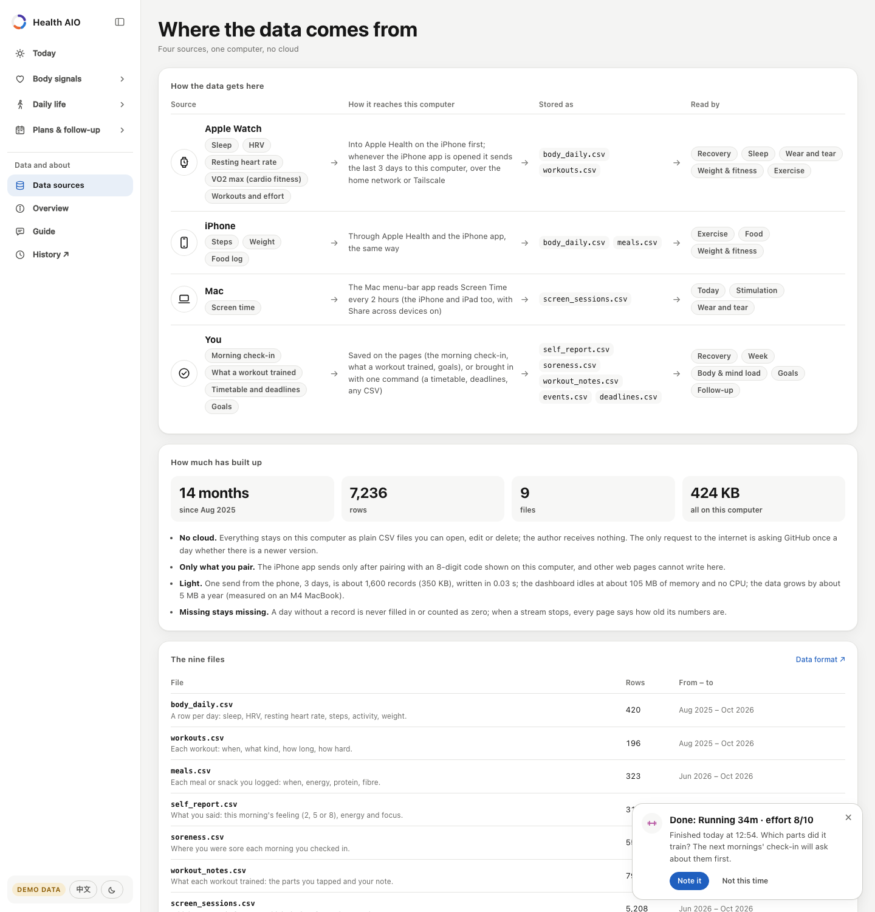
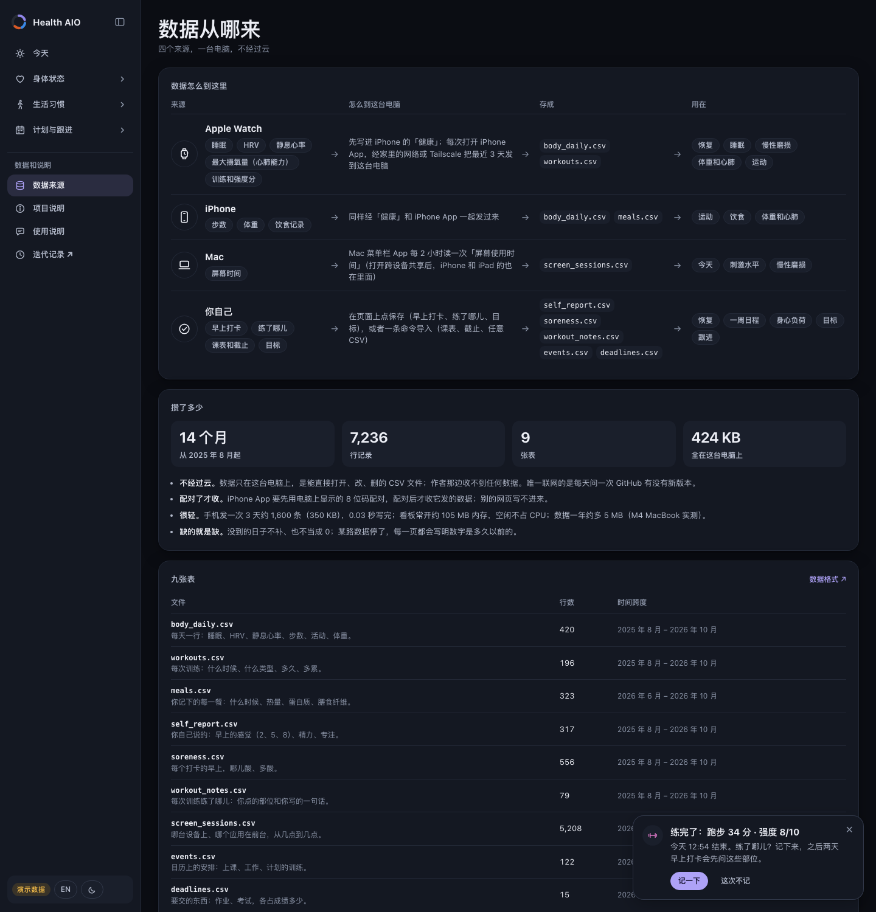

<div align="center">

# Proactive Health AIO · 主动健康管理 AIO

Proactive health management, all in one, on your own computer: sleep, exercise, food, weight, screens and your plans
in one place, each compared with your own normal, and every morning, what to adjust today and why.<br>
一站式的主动健康管理，跑在你自己的电脑上：睡眠、运动、饮食、体重、屏幕和计划放在一处，每一项都和你自己的平常比；每天早上告诉你今天该调整什么、为什么。

**[Live demo · 在线演示](https://wannian001.github.io/proactive-health-aio/)** (made-up data · 虚构数据) &nbsp;·&nbsp; [English](#english) &nbsp;·&nbsp; [中文](#中文)

</div>

## English


### Why it exists

| | |
|---|---|
| **Today** | Your health data is already being collected, in pieces: the watch has sleep, HRV, resting heart rate and workouts; a food app has your meals; Screen Time has your phone; the calendar has the week's load. |
| **The problem** | Each app answers its own question, against a population norm or its own score, and only when you go and look. Nothing puts "slept 6 hours, ate late three nights running, strength training planned for today" side by side and says what to change today. So most people use health data *reactively*: they look after they already feel bad. |
| **What makes it hard** | The signals have different units and different strength of evidence. Logs have gaps (a day you did not log food is not a day you ate nothing). Associations in one person's data are not causes. And this is the most private data you have. |
| **What people use now** | Wearable apps (Oura, WHOOP, Garmin Connect) turn their own device's data into a recovery score. Food loggers (MyFitnessPal, Cronometer) cover food. Screen Time covers screens. Apple Health stores almost everything but explains little. Cross-app trackers (Exist.io, Bearable) look for correlations between apps. |
| **What that costs you** | Several apps and often several subscriptions; your history in several clouds; scores whose formula you cannot check; and you still do the joining-up yourself. |
| **What this does instead** | Two small companion apps (Mac and iPhone) collect what your devices already record; one local app compares every signal with *your own* last 28 days (not a population), keeps every goal in one file, each morning names at most three things to adjust (at most one each for training, sleep, food and daytime screens) with the numbers behind each, and the next day checks against the data whether they happened, offering another way for the ones that keep not happening. Every rule is written down; nothing leaves the computer. |
| **Trade-offs, on purpose** | No cloud and no background sync: the iPhone app sends Apple Health to your own computer, over your home network or Tailscale, while it is open; without it you import an Apple Health export. Food needs a logging app that writes to Apple Health, or a CSV. The advice is a short list of fixed, explainable rules, not a model (an optional assistant only reads the sentence you type about where it feels tight; the moves it leads to are a fixed, reviewed list); it is about habits, not medical advice. A missing number stays missing, so a sparse log gives fewer answers, not made-up ones. |

### Rest and rewards

**Daily life → Rest & rewards**: one explainable next step, activities you can start and finish without a timer, reflections, and separate celebration plans. Rest never needs to be earned. How you feel right now is said once, on Recovery's “How you are right now” card; Today opens its list with the rest line when there is one, and what you tried is on Follow-up. Suggestions appear when the app is opened; background notifications are not implemented. [Design, behavior and data format](docs/REST_AND_REWARDS.md).

### The loop it runs

**Measure** (the Mac and iPhone apps collect what your devices already record) → **compare** (each signal against your own normal and your plan) → **adjust** (today's three things) → **follow up** (checked the next day against the data; another way when one keeps failing) → **check it helped** ("tomorrow will be better": what has gone with a better next day).

The menu is that loop, one question per item: **Body signals** are the outcomes you cannot change directly (recovery, sleep, wear and tear, weight & fitness); **Daily life** is what you do every day and can change (exercise, food, stimulation); **Plans & follow-up** is what you have planned and whether it held: the week on the calendar, how heavy the weeks are for body and mind, your goals, and whether yesterday's advice happened and helped.

| Menu | Page | Question it answers |
|---|---|---|
| **Today** | | One card for the morning: the day ring, how recovered you are against your own last 28 days, today's training and calendar in a line, when to be asleep tonight, and **what to adjust today** (at most three: at most one each for training, sleep, food and daytime screens, with the reason in a few words; a link checks yesterday's on Follow-up). Under it, every other part in one line with its number and state (sleep, HRV, resting heart rate, the week's exercise, food, screens, drain, weight, what helps you); a line opens its page. When Rest & rewards has something to say right now (you said you are tired, or your body signals are below your normal), the list opens with that line, marked Right now; it is about this moment, so it is not one of the three. |
| **Body signals** | Recovery | At the top, an illustrated body (four views) coloured by today's soreness, beside cards for soreness and energy with how long they usually take to come back for you. **How you are right now**, one card for everything you say: energy now (0–10, kept with its time), this morning's feeling in one tap (not recovered = 2, so-so = 5, recovered = 8), where you are sore (choose a region on the body above, three levels; 14 days per region in a fold, with the days each part was trained marked), and, if you like, your mind and the task in front of you. One Save writes each answer where it already lives. **After a strength session or a hard one** (effort 7 or more), every page pops up a note in the corner for 36 hours: tap the parts it trained on the figure, or say it in a sentence (typed, or dictated with the phone keyboard's microphone; "bench, rows, curls" lights up the torso and both upper arms by itself). The next two mornings, the check-in asks about those parts first, with a button per level. **The morning after training** is the app's one total score: four parts on 0–10, each against your own normal (5 is a usual morning): how you said you felt, HRV the morning after against the morning before, resting heart rate, and the night after (how long you slept, and how much of the time in bed you were asleep); added up and divided by how many there are, with every part shown beside it, the parts the session trained coloured by how sore they were the next morning, and 60 days of these scores as one dot per training day. How next-morning HRV, resting heart rate and soreness answer hard days is on Follow-up. A clearly sore region with training planned gives "spare the sore parts" on Today. Then Wear and tear (below), and at the bottom, once you have trained one, a next-day HRV forecast from your own history, shown with how it did against a plain 28-day median. |
| | Sleep | Tonight's times and how far the alarm plan has come; the last 7 nights against the 7 before; 21 nights on one axis and, in a tab, the alarm ladder (one step earlier after each on-time morning). Night-by-night checks are on Goals. |
| | ↳ Wear and tear | The last section of Recovery. What has been slowly wearing you down this week? Seven signals in three groups: what the body already shows (resting heart rate, HRV), sleep timing (the time you fall asleep, how much it moves night to night) and screen habits (screens before sleep, entertainment & social, app switching), each against your normal and your plan; plus whether short nights and hard training came in the same week. No total score. |
| | Weight & fitness | Weight as a 7-day average inside the corridor your plan allows, the weekly rate, and the long view; and **cardio fitness (VO2 max)**, which Apple Watch estimates on outdoor walks, runs and hikes: the level (a month's median) against your own level three months ago, and 12 months of estimates. It is the body's engine, built over weeks, not today's energy (that is Recovery). |
| **Daily life** | Exercise | This week against the weekly goal (your plan, or the WHO guideline of 150 active minutes and 2 strength days, and it says which), day by day with the training planned for the days to come; the last 7 days against your normal; training load against recovery; 12 weeks by kind (strength, cardio, walking); how HRV and resting heart rate tend to answer each kind the next morning. |
| | Food | The last 7 logged days against your normal and your plan: energy, protein (per kg of your weight), fibre, and the hours from the last meal to falling asleep; 14 days of meals by time of day with the hours before sleep striped; the food log set against the scale (the weekly change the log implies against the one the scale shows); what an early dinner has gone with the next morning. |
| | Stimulation | How stimulating were these 7 days? (What your body did next is on Follow-up, under “Tomorrow will be better”.) Hormones such as dopamine can't be measured by a phone or a watch, so the page shows no hormone number. It measures what goes in: five Screen Time signals, each against your normal (entertainment & social minutes, the level it leads with; entertainment in the hour before sleep; app switching; screens at once; the longest focus stretch). Then the long view (90 days of stimulation and focus as 7-day averages, the last 28 days next to the 28 before them), **how your body answered** (the night and next morning after stimulating days against the others: falling asleep, sleep, HRV, resting heart rate, with 95% intervals and a Benjamini–Hochberg correction; an association, never a cause), and in tabs: stimulation by hour of the day, devices at once, and which apps it came from. |
| **Plans & follow-up** | Schedule & load | Seven days of classes, deadlines and training on top; then what each week asks of you, the 8 behind and the 4 ahead. The body: **training load**, each workout's effort on Apple's 1–10 scale (your rating in the Fitness or Workout app, else the watch's estimate) times its minutes, the same idea as Apple Fitness's Training Load; weeks ahead hold the sessions you have planned, kept apart as planned. The mind: hours of classes and work on the calendar, and the share of grade due. Each is set against your own usual weeks and never added into one number (training load and share of grade are not the same kind of thing). It names the heaviest week ahead, the weeks when body and mind were loaded together, and a week ahead whose classes or deadlines are heavier than usual while the plan still holds your usual training: the week to plan lighter. Then 42 days of training load, the last 7 days against the 4 weeks before; it makes no claim to measure the nervous system (the morning after, on Recovery, is the body's answer). |
| | Goals | Every plan in one place: sleep, exercise, food, weight, screens, each with the last 28 days as kept / not kept / no record, counted as "n of the days with a record" (never a streak, never a score). **Set or change any goal right on the page**; a goal not set yet is listed with a button to set it. An assistant's proposals wait at the top until you accept or decline them. |
| | Follow-up | Did yesterday's advice happen? Each piece of the Today page's advice is checked the next day against the data (asleep by the time given, phone away, dinner early enough, protein, energy, entertainment & social under the cap), with nothing to tick, and the last 14 days of each are counted ("done n of the times with a record"). When one keeps failing (3 of its last 5 times), it offers **other ways with your own numbers** instead of the same reminder: a smaller step halfway from what you have been doing, a phone setting that remembers for you (Downtime, App Limits), and an if-then plan. Training advice is listed, not checked: rebuilding it would already know that day's workouts. At the bottom, **tomorrow will be better**: what has tended to help the next day (the next morning's HRV, resting heart rate and energy after doing something against not doing it, with 95% intervals), so the page answers both "did I do it?" and "did it help?". **Tomorrow will be better** holds every “what tends to help the next day” analysis in one place: things you do, hard training days (next-morning HRV, resting heart rate, soreness) and stimulating screen days (that night's sleep, next-morning HRV and resting heart rate). Rest you tried is one row per activity: how often, how many times you were better after, how many you were glad of. |
| *Data and about* | Data sources | Where the data comes from, for someone looking at how the app works: four sources (Apple Watch, iPhone, Mac, you) each drawn from what it records, to how it reaches this computer, to the files it is stored as, to the pages that read it (each a link); how much has built up (months, rows, files, size, all on this computer); what stays private and what it costs; and the nine files with a line each and their span. The daily check (90 days of arrivals under each device, rows that could not be read) and the import commands are folded at the bottom, for the person whose data it is. |
| | Overview & guide | What it is, who it is for, the problem it answers, where the data comes from (which device collects what, how often, what it costs your computer, measured), how proactive it is today, how it compares with what people use now, the trade-offs, where it stands and what comes next. It ends with the guide: look around the demo, install it, bring in your Apple Health export, set your goals, and what to open each day. |
| | [History ↗](https://tangjiakuo.top/demo/aio-history/en/) | Where this project comes from: the personal system it was taken out of, over a year and four generations, what each one found and what changed. It quotes that personal system, so it lives on the author's own site; the menu links out to it. |

<p>
  
  
</p>
<p>
  
  
</p>
<p>
  
  
</p>
<p>
  
  
</p>
<p>
  
  
</p>

English and Chinese, light and dark (it follows your system), phone and desktop. On a computer the menu is a sidebar
on the left that folds to a column of icons; on a phone it is a tab bar at the bottom. Data sources, Overview, Guide and a link to History sit under the menu (on a phone, small icons in the top row). Only the menu item you are in shows its pages; opening another closes it.

### How it decides what to say

- **You against you.** "Normal" is the 25th–75th percentile of your own previous 28 days, never a population norm.
  Two of three recovery signals worse than normal reads as "below your normal". The one place a population number
  appears is the WHO activity guideline, used only when you have set no exercise plan, and labelled as such.
- **Today's adjustments are rules you can read.** Recovery below normal with training planned → take it easy;
  a short night → tonight's time to be asleep by; late last meals on two or more of the last 7 logged nights → when to
  finish dinner; entertainment & social above your plan (or your normal) → a cap for today; and so on (the full list is
  in `healthaio/modules/actions.py` and on the page). At most three, at most one each for training, sleep, food and
  daytime screens; nothing off means "a steady day", never invented advice.
- **Advice is followed up, not repeated.** The next day each piece is checked against the data, with nothing to tick
  (`healthaio/modules/followup.py`); advice that failed on 3 of its last 5 times gets other ways with your own numbers
  (a smaller step, a phone setting, an if-then plan) instead of the same reminder.
- **Missing stays missing.** An empty cell is unknown, not zero. A day with fewer than two main meals logged is shown
  but not averaged; a day not logged at all is not a day of eating nothing. A day that was not over when the data
  synced is shown but not compared. When a stream stops, every page says how old its numbers are.
- **One total score, shown in parts.** The only total is the morning after training on Recovery: four parts that
  are each already "against your normal" on the same 0–10 scale, averaged, with every part beside it. Everything
  else keeps its signals apart (Wear and tear, Body & mind load): different units and different strength of evidence do not add up.
- **Associations, not causes.** "What has tended to help" compares the days after doing something with the days after
  not doing it, with 95% intervals and a Benjamini–Hochberg correction across the list. Only results that survive are
  coloured; the page says why you might train more on days you already feel good.
- **Colour means something.** Data colours follow the thing measured (focus is always blue, entertainment always
  orange, exercise always magenta, with lighter steps of it for kinds of training) and were checked for colour-vision
  deficiency. Green and red are kept for "better" and "worse" and always come with a word.

### Design kit

Every page is built from one design kit: the colour tokens of both modes, the components, the SVG charts and the
icons, in four files (`css/tokens.css`, `css/kit.css`, `js/charts.js`, `js/icons.js`). The
**[gallery](https://wannian001.github.io/proactive-health-aio/#kit)** shows all of them, each chart drawn from sample data
(it is not in the menu; every page links to it from its footer). Another app can take the kit with
`python3 -m healthaio kit export DIR` and later see whether its copy is up to date, outdated or changed locally with
`python3 -m healthaio kit check DIR`. How to use it, the colour rules and the versioning: [docs/DESIGN_KIT.md](docs/DESIGN_KIT.md).

### Quick start

Needs Python 3.9 or newer. No other packages.

```bash
git clone https://github.com/wannian001/proactive-health-aio.git
cd proactive-health-aio
python3 -m healthaio serve --demo
```

Open <http://localhost:8790>. With your own data:

```bash
cp examples/healthaio.example.toml healthaio.toml     # timezone, plans (sleep, exercise, food, weight, screens), devices
python3 -m healthaio import apple-health ~/Downloads/export.zip
python3 -m healthaio import ics ~/Downloads/timetable.ics --kind class
python3 -m healthaio import macos-screentime        # macOS only, experimental
python3 -m healthaio check                           # which rows could not be read
python3 -m healthaio serve
```

One Apple Health export brings in most of it: sleep, HRV, resting heart rate, steps, the Activity ring, energy burned,
weight, every workout with its times and average heart rate, and the meals that food-logging apps (MyFitnessPal,
Lose It!, Cronometer and others) write into Health. Deadlines, self-reports and anything else are plain CSV files you
can edit by hand or map from another export
(`python3 -m healthaio import csv meals my-food-log.csv --map "Date=time,Meal=meal,Calories=kcal,Protein=protein_g"`).

### Goals, and where an assistant plugs in

Set goals on the Goals page, or from the command line. Either way the change is a line in `goals.jsonl` next to
`healthaio.toml`, laid over the file (which stays as you wrote it), so the log is also the history of every change.
An assistant (any agent that can run a command) reads the pages as JSON and proposes; nothing changes until you
accept, on the Goals page or here:

```bash
python3 -m healthaio page goals                       # every goal and how often it was kept, as JSON
python3 -m healthaio goal propose screen.entertainment_max_hours 2.5 --note "A smaller step first"
python3 -m healthaio goal list                        # values now, where each comes from, open proposals
python3 -m healthaio goal accept <id>                 # or decline <id>; set FIELD VALUE to set one yourself
```

### The Mac app and the iPhone app

Two small companion apps take the manual steps away. Both are built from this repository on your own Mac, and
neither talks to anything but your own computer (and GitHub, once a day, to see whether there is a newer version).

| | What it does | Get it |
|---|---|---|
| **Mac app** (menu bar) | Holds Full Disk Access, so Screen Time is collected every 2 hours (your iPhone and iPad too, with "Share across devices" on). Keeps the dashboard running. When a new version is out it pops up and, if you say so, installs it. Pairs the iPhone with a QR code, and re-signs the iPhone app. | `mac/build.sh`, then [mac/README.md](mac/README.md) |
| **iPhone app** | Reads Apple Health (read only) and sends the last 3 days to your computer each time you open it; the dashboard is one of its tabs, so you can look while it sends. The first time it opens each day it checks whether its signature runs out soon (a free Apple ID signs for 7 days) or a newer version exists, and reminds you. | Xcode: [ios/README.md](ios/README.md) |

```bash
python3 -m healthaio serve --lan        # let your paired phone in (the Mac app does this for you)
python3 -m healthaio pair               # an 8-digit code for the iPhone app, good for 10 minutes
python3 -m healthaio collect            # Screen Time now (the Mac app runs it every 2 hours)
python3 -m healthaio update             # is there a newer version on GitHub; install it
python3 -m healthaio iphone renew       # re-sign and reinstall the iPhone app
```

How the phone and the computer talk, and what each side checks: [docs/CAPTURE.md](docs/CAPTURE.md).

**What it costs, measured on an M4 MacBook.** There is no server to carry: each person's computer is their own server,
and the only request to the internet is the daily version check (plus, if you switch it on, the assistant reading one sentence). One send from the phone is about 1,600 records and
350 KB for 3 days (counted from a real day of about 540 records) and takes 0.03 s to write into the tables; one Screen
Time collection (four weeks, 3 devices, about 6,900 stretches) takes 0.4 s; the dashboard holds about 105 MB of memory,
no CPU when idle, and computes a page in 0.004–0.36 s; the data grows by about 5 MB a year, mostly screen records.
Setting up: about 6 s to download, 20 s to build the Mac app, and Xcode (3.7 GB) for the iPhone app. Where it stands:
collection has run on the author's Mac with real Screen Time; the iPhone app has been tested in the simulator, not yet
on a real phone with real data; nobody but the author has installed it yet.

### Your data stays on your computer

- Data lives in plain CSV files in a folder you choose ([format](docs/DATA_FORMAT.md)). Importers write them
  ([how each importer works](docs/IMPORTERS.md)); the dashboard reads them, and writes only what the next bullet says.
- The server listens on `127.0.0.1`. With `--lan` it also answers your home network and Tailscale, and there only
  the devices you paired: each holds its own tokens, the server keeps only their hashes, and `healthaio devices revoke`
  cuts one off. What a phone may send is a package of Apple Health samples; it is kept as sent under `.healthaio/`
  and written into the same CSV files. The iPhone app sends "Apple Watch" or "iPhone", never the names you gave your
  devices.
- A page accepts writes only from the app's own page (here, or the panel in your paired phone): a
  goal you set on the Goals page, a line in `goals.jsonl` next to `healthaio.toml`; the morning check-in you save
  on the Recovery page, which sets that morning's `feel` in `self_report.csv` and replaces that morning's rows in
  `soreness.csv`; energy you rate on the same card, appended with its time to `recovery_observations.jsonl`; what a
  workout trained, which replaces that workout's row in `workout_notes.csv`; and rest, feelings, reflections and
  celebration events in the separate private `restore.jsonl` log.
- The one request to the internet is the daily update check: a call to the GitHub API that sends nothing but the
  version number. `[updates] check = false` in healthaio.toml turns it off.
- The assistant is off unless you switch it on (`[assistant] enabled = true`, and `pip install anthropic`). Then the
  sentence you type on Recovery about where it feels tight, and the fixed lists of places and feelings, are sent to
  Anthropic's API to be read; nothing else (no measurements, dates or name). The key is whatever the Anthropic SDK
  finds itself (`ANTHROPIC_API_KEY` or an `ant auth login` profile); the app never reads or stores it. Without the
  assistant, or if it fails, the same sentence is read with fixed word lists.
- `build-static` (used for the demo site) refuses to run on your own data unless you pass a flag that says you mean to
  publish it.

### How it is built

```
importers ─▶ data/*.csv ─▶ store (checked against schema.py) ─▶ page modules ─▶ JSON ─▶ web app
 Apple Health, .ics,          one table per file,                today, exercise, food,   vanilla JS,
 Screen Time, any CSV         bad rows reported, not fatal       goals, sleep, time, ...  hand-drawn SVG
```

- `healthaio/schema.py` is the single definition of every table; `docs/DATA_FORMAT.md` is generated from it.
- Each page module returns numbers, units, bands and states, never sentences. The browser writes the words, which is
  why one payload reads in both languages (`healthaio/web/js/i18n.js`).
- `python3 -m healthaio page today` prints a page's JSON (today's adjustments included), so a script or an AI
  assistant can read the same numbers the page shows.
- The demo site is the same app with pre-rendered JSON (`python3 -m healthaio build-static --demo`), served by GitHub
  Pages. The demo person, Sam, is made up: a graduate student with a night-owl sleep, a weight plan, a food log with
  late snacks before deadlines, and the screen habits of most students.
- Design notes: [docs/DESIGN.md](docs/DESIGN.md); the shared look is the design kit ([docs/DESIGN_KIT.md](docs/DESIGN_KIT.md), gallery at `#kit`).

### Development

```bash
python3 -m unittest discover -s tests      # runs on Python 3.9–3.13
python3 -m healthaio page food --demo --today 2026-10-12
```

The iPhone app has its own tests (`xcodebuild test`, see [ios/README.md](ios/README.md)); both sides read the example
packages in `tests/fixtures/capture/`, so the protocol cannot drift on one side only.

### Not medical advice

This is a tool for noticing patterns in your own habits. It does not diagnose anything, and its suggestions are
everyday habits (sleep earlier, eat earlier, train lighter). For anything about your health, talk to a professional.

### Where it comes from

This project started as *dayring*, the public showcase of a personal system I use every day; the day ring at the top
of Today is where the old name came from, and links to the old repository still redirect here. My own version has
more features and runs on my real watch, phone and laptop data; it takes its look from the design kit here. This
repository contains none of that data.

### License

[MIT](LICENSE)

---

## 中文

**生活习惯 → 休息与奖励**：一条说得出理由的建议，选一项活动、开始和结束都不计时，结束后可选填感受；庆祝计划单独保存，休息不需要用完成任务来换。此刻的感受只在恢复页的「此刻怎么样」里说一次；今天页有休息建议时放在清单最上面，试过哪些在跟进页。当前在打开应用时显示建议，尚无后台推送。[功能与数据说明](docs/REST_AND_REWARDS.md)。


### 为什么做这个

| | |
|---|---|
| **现状** | 你的健康数据其实已经在被记录，只是散在各处：手表里有睡眠、HRV、静息心率和训练；饮食 App 里有每一餐；屏幕使用时间里有手机；日历里有这周有多忙。 |
| **问题** | 每个 App 只回答自己那一个问题，拿人群标准或者它自己的分数来比，而且要你自己点进去看。没有谁会把“只睡了 6 小时、连续三晚吃得晚、今天又排了力量训练”放在一起，告诉你今天该改什么。所以大多数人用健康数据是**被动**的：已经不舒服了才去看。 |
| **难在哪** | 各种信号单位不同、证据强弱不同；记录有缺口（某天没记饮食，不等于那天没吃东西）；一个人数据里的关联不是因果；而且这是你最私密的数据。 |
| **现在大家用什么** | 穿戴设备的 App（Oura、WHOOP、Garmin Connect）把自家设备的数据算成一个恢复分；记饮食的 App（MyFitnessPal、薄荷健康、Cronometer）只管吃；屏幕使用时间只管屏幕；Apple 健康几乎什么都存，但很少解释；跨 App 的追踪工具（Exist.io、Bearable）在不同 App 之间找相关。 |
| **它们带来的负担** | 好几个 App、往往还有好几份订阅；你的历史散在好几家云上；分数怎么算的你查不到；最后把这些拼起来的还是你自己。 |
| **这里的做法** | Mac 和 iPhone 上的两个小 App 把设备已经记下的收过来；一个本地的 App 把每个信号都和**你自己**最近 28 天比（不和人群比），所有目标写在一个文件里；每天早上最多点出三件该调整的事（训练、睡眠、饮食、白天的屏幕各最多一件），每件都写明依据的数字；第二天按数据核对做到没有，老做不到的换个做法。每条规则都写在明处，数据不出这台电脑。 |
| **有意做的取舍** | 不走云、不在后台同步：iPhone App 打开时把 Apple 健康的数据发到你自己的电脑上（家里的网络或 Tailscale）；不装它，也可以导入一次 Apple 健康的导出包。饮食要靠一个会写进 Apple 健康的记录 App，或者一份 CSV。建议是一小组固定、讲得清的规则，不是模型（可选的助手只负责读懂你说的“哪里紧”那句话，后面给的动作是一份固定、审过的清单）；管的是生活习惯，不是医疗建议。缺的数就是缺，记得少，得到的回答就少，而不是编出来的回答。 |

### 它跑的闭环

**记录**（Mac 和 iPhone 的小 App 把设备已经记下的收过来）→ **对比**（每个信号对比你自己的平常、对比你的计划）→ **调整**（今天的三件事）→ **跟进**（第二天按数据核对做到没有；老做不到就换个做法）→ **验证**（“明天会更好”：做了什么，第二天真的更好）。

菜单就是这个闭环，一项回答一个问题：**身体状态**是结果，你没法直接改（恢复、睡眠、慢性磨损、体重和心肺）；**生活习惯**是你每天做的事，能直接改（运动、饮食、刺激水平）；**计划与跟进**是你计划了什么、做到没有：日历上的一周、每周对身体和精神提了多少要求、你的目标，以及昨天的建议做到没有、有没有用。

| 菜单 | 页面 | 回答的问题 |
|---|---|---|
| **今天** | | 早上看的一张卡：一天的环、恢复和你自己最近 28 天比怎么样、今天的训练和日程一行、今晚几点睡着，以及**今天该调整的**（最多三件：训练、睡眠、饮食、白天的屏幕各最多一件，原因几个字说清；下面有个链接去“跟进”看昨天的做到没有）。下面是其他各项，一项一行，只写数字和状态（睡眠、HRV、静息心率、本周运动、饮食、屏幕、消耗、体重、对你有用的），点一行进它的页面。「休息与奖励」此刻有话要说时（你说累了，或者身体信号低于平常），这份清单最上面多一行「此刻」；它说的是现在，不算在三件里。 |
| **身体状态** | 恢复 | 最上面是一张人体插画（四个视角），按今天哪里酸上色；旁边是酸痛和精力两张卡（按你自己的历史，一般多久能缓回来）。**此刻怎么样**，你要说的都在这一张卡里：此刻的精力（0–10，带着时间存下来）；今天早上感觉怎么样，点一下（没缓过来 = 2、一般 = 5、恢复得好 = 8）；哪里酸（在上面的人体图上选部位，每个部位三档；每个部位最近 14 天收在折叠里，练过的那天有标记）；愿意的话再说精神状态和眼前的任务。点一次保存，每一项存到它原来的地方。**练完力量训练或强度高的训练**（强度分 7 以上），36 小时内每一页的角落都会弹出提示：在人体图上点练了哪儿，或者说一句（打字，或者用手机键盘的麦克风口述；写“卧推、划船、二头”会自动点亮躯干和两侧上臂）。之后两天早上打卡，会先用按钮问这些部位酸不酸。**练后第二天**是应用里唯一的总分：四项都换成 0–10、各自和你的平常比（5 分是平常的一个早上）：你答的感觉、HRV（练后那个早上和练前那个早上比）、静息心率、练后那一晚（睡了多久，在床上有多少时间是睡着的）；加起来除以项数，每一项都摊开写在旁边，这次练到的部位按第二天早上酸不酸上色，下面是最近 60 天的分，每个训练日一个点。练得重的日子之后第二天早上的 HRV、静息心率和酸痛怎么回应，在跟进页。某个部位明显酸、今天又排了训练，“今天”页会提醒“避开酸的部位”。再往下是慢性磨损（见下一行）；最下面是用你自己的历史训练的“明天 HRV”预测（训练过才显示），并写清它比简单的 28 天中位数好多少。 |
| | 睡眠 | 今晚几点睡、闹钟前移计划走到哪了；最近 7 晚和再往前 7 晚比；21 晚画在同一根轴上，另一个标签是闹钟台阶（每按时起一天，闹钟往前挪一步）。每晚的打勾在目标页。 |
| | ↳ 慢性磨损 | 现在是恢复页的最后一段。这一周哪些东西在慢慢磨损你？七个信号分三组：身体已经显出来的（静息心率、HRV）、作息（入睡时刻、每晚差多少）、屏幕习惯（睡前屏幕、娱乐和社交、应用切换），各自和平常比、和计划比；另外看睡得少和练得狠有没有撞在同一周。不打总分。 |
| | 体重和心肺 | 体重 7 天平均是不是在计划允许的走廊里、每周降多少、长期走势；还有**心肺能力（最大摄氧量）**，Apple Watch 在户外步行、跑步、徒步时估算：一个月的中位数，和你自己 3 个月前比，加最近 12 个月的走势。它是体力的底子，要几周才练得出来，不是今天的精力（今天累不累看“恢复”）。 |
| **生活习惯** | 运动 | 本周对照每周目标（你的计划，没设就用世卫组织建议的每周 150 分钟活动、2 天力量训练，并写明用的是哪个），一天一格，还没到的日子写着计划的训练；最近 7 天对比平常；训练负荷对照恢复；12 周按种类（力量、有氧、步行）；每种训练后第二天早上的 HRV 和静息心率通常怎么样。 |
| | 饮食 | 最近 7 天里记全的日子对比平常、对比计划：热量、蛋白质（按体重每公斤算）、膳食纤维、最后一餐到睡着隔了几小时；最近 14 天每一餐在一天里的时刻，睡前几小时画斜纹；饮食记录和体重秤对账（按记录该每周变多少、秤上实际变多少）；早点吃完晚饭的第二天早上有什么不同。 |
| | 刺激水平 | 这 7 天刺激多不多？（身体接下来怎么回应，在跟进页的“明天会更好”里。）多巴胺这类激素手机和手表测不了，所以页面上没有激素的数。它量的是输入：屏幕使用时间里的五个信号，各自和平常比（娱乐和社交时长，是页面先说的那个水平；睡前一小时的娱乐和社交；切换应用；几台同时用；最长一段专注）。接着是长期走势（90 天的刺激和专注，7 天平均，最近 28 天和再之前 28 天并排）、**身体怎么回应**（刺激多的日子之后的当晚和第二天早上，和其他日子比：入睡时刻、睡眠时长、HRV、静息心率，带 95% 区间和 Benjamini–Hochberg 校正；只说相关，不说因果），标签里还有：一天里什么时候刺激最多、几台同时用、刺激来自哪些应用。 |
| **计划与跟进** | 日程与负荷 | 上面是七天的课、截止和训练；下面是每周对你提了多少要求，过去 8 周和接下来 4 周。身体：**训练负荷**，每次训练的强度分（Apple 的 1–10 分：你在健身或体能训练 App 里打的分，没有就用手表估的）乘以分钟数，思路和 Apple 健身 App 的训练负荷一样；接下来几周放的是你排了的训练，单独标成“计划”。精神：日历上课和工作的小时数，以及截止占成绩的比例。每一项各自和你平常的周比，从不加成一个数（训练负荷和占分不是一种东西）。它点出接下来最重的一周、身体和精神叠在一起的那几周，以及课或截止比平常重、训练却还照常排的那一周：该提前减量。下面是最近 42 天的训练负荷，最近 7 天和之前 4 周比；它不声称测的是神经系统（身体的回答看“恢复”页的练后第二天）。 |
| | 目标 | 所有计划放在一处：睡眠、运动、饮食、体重、屏幕，每个目标把最近 28 天画成做到 / 没做到 / 没记录，计数写成“有记录的日子里做到几天”（不算连续天数，也不打分）。**目标可以直接在页面上设、随时改**；没设的目标列出来，旁边有“设一个”。AI 助手提的建议放在最上面，你采纳或不要之前什么都不变。 |
| | 跟进 | 昨天的建议做到了没有？“今天”页的每条建议，第二天按数据核对（按时睡着、按时放下手机、晚饭够早、蛋白质、热量、娱乐和社交不超上限），不用你打勾；每条建议最近 14 天给了几次、有记录的那几次做到几次。同一条老做不到（最近 5 次里 3 次以上），就不再重复提醒，而是给**按你自己的数字算的其他做法**：把一步改小（取你最近的实际和目标的中间）、让手机替你记（停用时间、App 限额）、写一句“如果……就……”。训练类建议列出来但不核对：重算时已经看得到那天练了什么。最下面是**明天会更好**：做了和没做的日子，第二天早上的 HRV、静息心率和精力有什么不同（带 95% 区间）。这样这一页既回答“做到没有”，也回答“有没有用”。**明天会更好**把所有“做什么第二天更好”的分析放在一处：你做的事、练得重的日子（第二天早上的 HRV、静息心率、酸痛）、屏幕刺激多的日子（当晚的睡眠、第二天早上的 HRV 和静息心率）。试过的休息每种活动一行：做了几次、几次之后变好、几次开心。 |
| *数据和说明* | 数据来源 | 数据从哪来，写给想看这个应用怎么运作的人：四个来源（Apple Watch、iPhone、Mac、你自己），每个一行，从“记了什么”到“怎么到这台电脑”、“存成哪几张表”、“用在哪几页”（可以点）；攒了多少（几个月、多少行、几张表、多大，全在这台电脑上）；隐私和开销；九张表各一句说明和时间跨度。每天到了哪些（按设备 90 天、读不出的行）和导入命令折叠在最下面，留给数据的主人自己查。 |
| | 项目说明与用法 | 它是什么、为谁做、解决什么问题、数据从哪来（哪台设备收什么、多久一次、在你电脑上的开销，实测）、“主动”到哪一步、和现在常用的比、有意的取舍、现在到哪一步、接下来做什么。最后是使用说明：先看演示，装到自己电脑上，导入 Apple 健康的导出包，设目标，以及每天该看哪里。 |
| | [迭代记录 ↗](https://tangjiakuo.top/demo/aio-history/) | 这个项目的来历：它是从作者自己用了一年的个人系统里抽出来的；那个系统换了四代，每一代发现了什么、改了什么。它引了那个个人系统里的内容，所以放在作者自己的网站上，菜单里是一个指过去的链接。 |

<p>
  
  
</p>
<p>
  
  
</p>
<p>
  
  
</p>
<p>
  
  
</p>
<p>
  
  
</p>

界面中英双语，浅色和深色（默认跟随系统），手机和电脑都能用。电脑上菜单是左边的侧栏，能收成一列图标；手机上是底部的标签栏。数据来源、项目说明、使用说明和迭代记录的链接在菜单下面（手机上是顶栏的小图标）。只有你所在的那一项会展开子页，展开别的一项，前一项就收起。

### 它怎么判断

- **只和自己比。** “平常”是你自己之前 28 天的第 25–75 百分位，从不拿人群标准比。三项恢复指标里两项以上变差，就说“恢复低于平常”。唯一出现人群数字的地方是世卫组织的活动建议，只在你没设运动计划时用，而且标明了出处。
- **今天的调整是看得懂的规则。** 恢复低于平常、今天又排了训练 → 放轻松；昨晚睡少了 → 今晚几点前睡着；最近 7 个记全的晚上有 2 晚以上最后一餐离睡觉太近 → 几点前吃完晚饭；娱乐和社交高于计划（没设计划时高于平常）→ 今天的上限；等等（完整列表在 `healthaio/modules/actions.py` 和页面上）。最多三件，训练、睡眠、饮食、白天的屏幕各最多一件；没有偏离就写“照计划来”，绝不编建议。
- **建议要跟进，不是重复。** 第二天按数据核对每条建议做到没有，不用打勾（`healthaio/modules/followup.py`）；最近 5 次里 3 次以上没做到的，不再重复同一句提醒，而是给按你自己的数字算的其他做法（把一步改小、让手机的设置替你记、写一句“如果……就……”）。
- **缺的就是缺。** 空格表示不知道，不当成 0。一天记了不到两顿正餐，照样显示但不算平均；一天完全没记，不等于那天没吃。同步时还没过完的那天照样显示，但不跟平常比。某路数据停了，每一页都会写明数字是多久以前的。
- **只有一个总分，而且摊开给你看。** 唯一的总分是“恢复”页的练后第二天：四项各自先和你的平常比、换成同一把 0–10 的尺子，再取平均，每一项都写在旁边。其他地方各项分开放（慢性磨损、身心负荷）：单位不同、证据强弱不同的东西加不到一起。
- **是关联，不是因果。** “做什么第二天会更好”拿做了和没做的第二天比，给 95% 区间，整张表一起做 Benjamini–Hochberg 校正，只有校正后还成立的才上颜色；页面也写明为什么状态好的日子本来就更可能去练。
- **颜色有含义。** 数据颜色跟着被测的东西走（专注永远是蓝，娱乐永远是橙，运动永远是品红，训练种类用它的浅几档来分），做过色弱校验；绿和红只用来表示更好和更差，而且一定配文字。

### 设计套件

每一页都出自同一套设计套件：两种模式的颜色变量、组件、SVG 图表和图标，放在四个文件里（`css/tokens.css`、`css/kit.css`、`js/charts.js`、`js/icons.js`）。**[展示页](https://wannian001.github.io/proactive-health-aio/#kit)**把它们全摆出来，每张图都用示例数据现场画（展示页不在菜单里，每一页底部都有链接）。别的应用可以用 `python3 -m healthaio kit export DIR` 拷走这套文件，之后用 `python3 -m healthaio kit check DIR` 查自己那份是最新、过期还是本地改过。怎么用、颜色规则和版本规则见 [docs/DESIGN_KIT.md](docs/DESIGN_KIT.md)。

### 快速开始

需要 Python 3.9 以上，不用装别的包。

```bash
git clone https://github.com/wannian001/proactive-health-aio.git
cd proactive-health-aio
python3 -m healthaio serve --demo
```

打开 <http://localhost:8790>。换成你自己的数据：

```bash
cp examples/healthaio.example.toml healthaio.toml     # 时区、计划（睡眠、运动、饮食、体重、屏幕）、设备
python3 -m healthaio import apple-health ~/Downloads/export.zip
python3 -m healthaio import ics ~/Downloads/timetable.ics --kind class
python3 -m healthaio import macos-screentime        # 只限 macOS，试验性
python3 -m healthaio check                           # 看哪些行读不出
python3 -m healthaio serve
```

一个 Apple 健康导出包就能带进来大部分：睡眠、HRV、静息心率、步数、活动圆环、消耗的热量、体重、每次训练（带起止时间和平均心率），以及记饮食的 App（MyFitnessPal、Lose It!、Cronometer 等）写进健康里的每一餐。截止日期、自评等其他数据都是普通 CSV，可以手改，也可以从别的导出文件映射过来
（`python3 -m healthaio import csv meals my-food-log.csv --map "Date=time,Meal=meal,Calories=kcal,Protein=protein_g"`）。

### 目标，以及 AI 助手从哪里接进来

目标在目标页设，也可以用命令行设。两种方式都是在 `healthaio.toml` 旁边的 `goals.jsonl` 里加一行，叠在文件上面用
（文件本身不动），所以这份记录也是每一次改动的历史。AI 助手（任何能运行命令的代理）读每一页的 JSON，提出建议；
你在目标页或下面这样采纳之前，什么都不变：

```bash
python3 -m healthaio page goals                       # 每个目标和做到了几天，JSON
python3 -m healthaio goal propose screen.entertainment_max_hours 2.5 --note "先小步收"
python3 -m healthaio goal list                        # 现在的值、各自从哪来、待决定的建议
python3 -m healthaio goal accept <id>                 # 或 decline <id>；自己设用 set 字段 值
```

### Mac App 和 iPhone App

两个配套的小 App 把手动的步骤省掉。两个都在你自己的 Mac 上从这个仓库编出来，除了你自己的电脑什么都不连（另外每天问一次 GitHub 有没有新版本）。

| | 做什么 | 怎么装 |
|---|---|---|
| **Mac App**（菜单栏） | 拿着“完全磁盘访问权限”，每 2 小时采一次屏幕使用时间（打开“跨设备共享”后，iPhone 和 iPad 的也在里面）。让看板一直开着。GitHub 上有新版本时弹窗提醒，你点更新就装上。用二维码配对 iPhone，也负责给 iPhone App 续签。 | `mac/build.sh`，然后看 [mac/README.md](mac/README.md) |
| **iPhone App** | 只读 Apple 健康，每次打开把最近 3 天发到你的电脑；看板是它的一个标签页，发的同时也能看。每天第一次打开时检查签名是不是快到期了（免费 Apple ID 签一次管 7 天）、有没有新版本，有就提醒你。 | 用 Xcode：[ios/README.md](ios/README.md) |

```bash
python3 -m healthaio serve --lan        # 让配对过的手机连进来（Mac App 会替你开）
python3 -m healthaio pair               # 给 iPhone App 的 8 位配对码，10 分钟内有效
python3 -m healthaio collect            # 现在采一次屏幕使用时间（Mac App 每 2 小时自动采）
python3 -m healthaio update             # GitHub 上有没有新版本，有就装上
python3 -m healthaio iphone renew       # 给 iPhone App 续签并重新装上
```

手机和电脑之间怎么传、两边各检查什么：[docs/CAPTURE.md](docs/CAPTURE.md)。

**开销（在一台 M4 MacBook 上实测）。** 没有服务器要扛：每个人的电脑就是自己的服务器，唯一联网的是每天一次检查新版本（你打开助手的话，再加上读那一句话）。手机发一次
3 天约 1,600 条记录、约 350 KB（条数按真实的一天约 540 条算），电脑写进表里用 0.03 秒；采一次屏幕使用时间（4 周、3 台设备、约
6,900 段）0.4 秒；看板常开约 105 MB 内存，空闲时 CPU 为 0，每页 0.004–0.36 秒算完；数据一年约 5 MB，大头是屏幕记录。装一次：
下载约 6 秒，构建 Mac App 约 20 秒，装 iPhone App 要 Xcode（本体 3.7 GB）。现在到哪一步：在作者的 Mac 上用真实的屏幕使用时间
跑过采集；iPhone App 在模拟器上测过，还没在真手机上读过真数据；还没有作者以外的人装过。

### 数据只在你的电脑上

- 数据是你指定文件夹里的普通 CSV（[格式](docs/DATA_FORMAT.md)）。导入工具写它们（[每个导入工具怎么工作](docs/IMPORTERS.md)），看板只读，下一条列出的记录除外。
- 服务只监听 `127.0.0.1`。加 `--lan` 后也接受家里的网络和 Tailscale，但只认你配对过的设备：每台设备有自己的令牌，服务器只存令牌的哈希，`healthaio devices revoke` 随时断开一台。手机能发的只有 Apple 健康的样本包，原样存在 `.healthaio/` 里，再写进同样的 CSV。iPhone App 只发“Apple Watch”“iPhone”这样的型号，从不发你给设备起的名字。
- 页面写入只接受这个应用自己页面发来的（这台电脑上的，或者配对过的手机里的面板）：你在目标页设的目标，一行记在 `healthaio.toml` 旁边的 `goals.jsonl` 里；你在恢复页保存的早上打卡，只改那天早上 `self_report.csv` 里的 `feel`，并替换那天早上在 `soreness.csv` 里的几行；同一张卡上打的精力分，带着时间追加到 `recovery_observations.jsonl`；练完记下的练了哪儿，只替换那次训练在 `workout_notes.csv` 里的一行；当前感受、休息活动、可选反馈与庆祝计划，追加到独立的私有 `restore.jsonl`。
- 唯一联网的是每天一次的更新检查：问一次 GitHub API，除了版本号什么都不发。在 healthaio.toml 里写 `[updates] check = false` 就关掉。
- 助手默认关着，要你自己打开（`[assistant] enabled = true`，再 `pip install anthropic`）。打开后，你在恢复页说的“哪里紧”那一句话，连同固定的部位和感觉清单，会发给 Anthropic 的 API 去读；别的都不发（没有测量数据、日期和名字）。API key 由 Anthropic SDK 自己找（`ANTHROPIC_API_KEY` 或 `ant auth login` 的登录信息），应用不读也不存。不开助手，或者助手出错时，同一句话按固定词表来读。
- `build-static`（演示站用的）遇到你自己的数据会拒绝运行，除非你加一个明确表示“我要公开”的参数。

### 怎么搭的

```
导入工具 ─▶ data/*.csv ─▶ 读取层（按 schema.py 检查）─▶ 各页计算 ─▶ JSON ─▶ 网页
Apple 健康、.ics、        一张表一个文件，              今天、运动、饮食、      原生 JS，
屏幕使用时间、任意 CSV    坏行只报告、不中断            目标、作息、时间……     手画 SVG
```

- `healthaio/schema.py` 是所有表的唯一定义，`docs/DATA_FORMAT.md` 由它生成。
- 每页的计算只返回数字、单位、平常范围和状态，不返回句子；文字由浏览器写，所以同一份数据能切中英文（`healthaio/web/js/i18n.js`）。
- `python3 -m healthaio page today` 打出一页的 JSON（包括今天该调整的），脚本或 AI 助手读到的数和页面上的一样。
- 演示站就是同一个网页加上预先算好的 JSON（`python3 -m healthaio build-static --demo`），放在 GitHub Pages 上。演示里的 Sam 是虚构的：一个研究生，夜猫子作息，有体重计划，记饮食（赶截止那几天会吃夜宵），屏幕习惯和大多数学生一样。
- 设计说明：[docs/DESIGN.md](docs/DESIGN.md)；共用的外观是设计套件（[docs/DESIGN_KIT.md](docs/DESIGN_KIT.md)，展示页在 `#kit`）。

### 开发

```bash
python3 -m unittest discover -s tests      # Python 3.9–3.13 都能跑
python3 -m healthaio page food --demo --today 2026-10-12
```

iPhone App 有自己的测试（`xcodebuild test`，见 [ios/README.md](ios/README.md)）；两边读的是同一组示例包 `tests/fixtures/capture/`，协议改了一边，另一边的测试就会失败。

### 不是医疗建议

这是用来发现你自己生活习惯里规律的工具，不做任何诊断；它给的建议都是日常习惯（早点睡、早点吃、练轻一点）。涉及健康的事，请找专业人士。

### 来历

这个项目原来叫 *dayring*，是我每天在用的个人系统的公开展示版；今天页顶上那个“一天的环”就是旧名字的来历，旧仓库的链接也会自动跳到这里。我自己那一版功能更多，用的是真实的手表、手机和电脑数据；它的外观来自这里的设计套件。这个仓库里没有任何那边的数据。

### 许可

[MIT](LICENSE)
